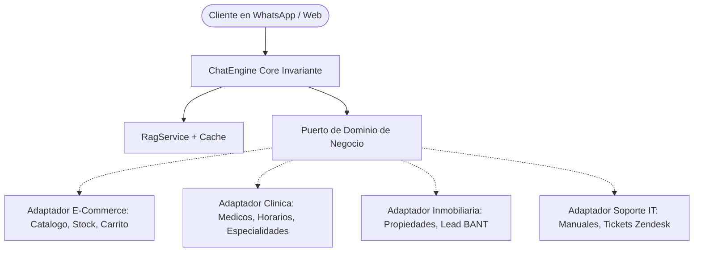
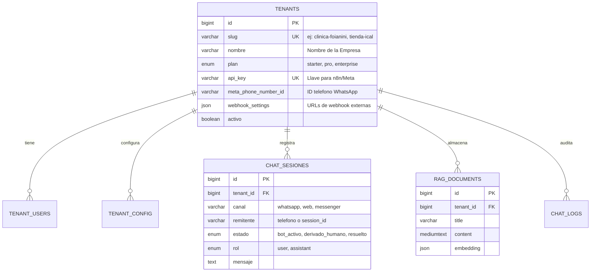
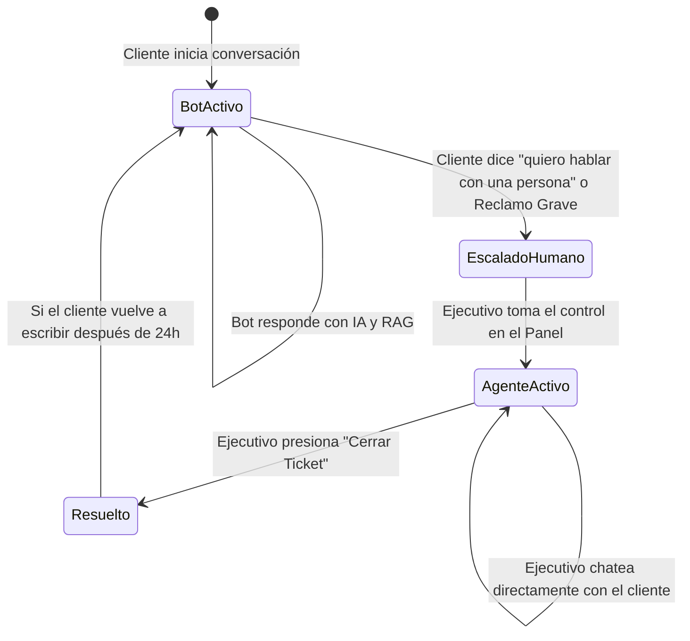

# ARQUITECTURA DE DESACOPLE Y ROADMAP B2B SAAS
## Transformación de Chatbot E-Commerce a Plataforma Omnicanal de IA Empresarial

**Fecha de Creación:** 25 de Octubre de 2026  
**Documento Estratégico:** Guía de Ingeniería para Desacople y Comercialización Corporativa  
**Referencia del Núcleo Actual:** [services/chat/ChatEngine.php](file:///c:/xampp/htdocs/ventas-ia-main/services/chat/ChatEngine.php) y [config/domain_profile.json](file:///c:/xampp/htdocs/ventas-ia-main/config/domain_profile.json)

---

## 1. Visión del Producto: ¿Qué estamos vendiendo?

El producto final no es *"un bot para una tienda"*, sino una **Plataforma de Asistentes Cognitivos Omnicanal Multi-Empresa**:

> *"Un motor inteligente que se conecta a WhatsApp, Instagram, Messenger y páginas web en 5 minutos, sincronizándose con la base de conocimiento y los sistemas internos (CRM, ERP, Calendario o Tienda) de cualquier negocio sin escribir código."*

---

## 2. El Desacople Radical del E-Commerce (Arquitectura Hexagonal)

### El Problema Actual
En el código original, el motor asume que todo negocio tiene:
* Una tabla `productos` con `precio`, `stock` e `imagen_url`.
* Una acción fija de `agregar_carrito`.
* Una tabla `categorias` para filtrar vitrinas de compra.

Si mañana tu cliente es un **Hospital**, un **Bufete de Abogados**, una **Inmobiliaria** o un **Instituto Educativo**, no existen "carritos de compra" ni "productos en Bs".

### La Solución: Puertos y Adaptadores (Ports & Adapters)

El núcleo conversacional ([ChatEngine.php](file:///c:/xampp/htdocs/ventas-ia-main/services/chat/ChatEngine.php), [SessionLock.php](file:///c:/xampp/htdocs/ventas-ia-main/services/chat/SessionLock.php), [RateLimiter.php](file:///c:/xampp/htdocs/ventas-ia-main/services/chat/RateLimiter.php), [InputSanitizer.php](file:///c:/xampp/htdocs/ventas-ia-main/services/chat/InputSanitizer.php) y [RagService.php](file:///c:/xampp/htdocs/ventas-ia-main/services/rag/RagService.php)) es el **Core Invariante**. 

Para desacoplar el negocio, creamos dos interfaces fundamentales:
1. `BusinessDomainInterface`: Provee los datos y reglas de negocio.
2. `ActionHandlerInterface`: Procesa lo que el cliente quiere hacer.



### Contrato PHP: Interfaz de Dominio de Negocio
Creamos `services/chat/Contracts/BusinessDomainInterface.php`:

```php
namespace Services\Chat\Contracts;

interface BusinessDomainInterface
{
    /** Nombre comercial y personalidad base */
    public function getIdentidad(): array;

    /** Resumen de contexto inyectable al prompt (en lugar de catálogo forzado) */
    public function getPromptContext(): string;

    /** Búsqueda estructurada de entidades (productos, médicos, inmuebles, trámites) */
    public function buscarEntidades(string $termino, array $filtros = []): array;

    /** Catálogo de herramientas o acciones permitidas para este negocio */
    public function getHerramientasDisponibles(): array;

    /** Ejecución segura de una acción solicitada */
    public function ejecutarAccion(string $tipoAccion, array $parametros, array $contextoSesion): array;
}
```

### Ejemplos de Adaptadores por Industria

| Industria | Entidades que provee | Acciones que ejecuta (`ejecutarAccion`) |
| :--- | :--- | :--- |
| **Retail / E-Commerce** (Actual) | Productos, Precios, Stock, Tallas. | `agregar_carrito`, `generar_link_pago`, `rastrear_pedido`. |
| **Clínicas / Consultorios** | Especialidades, Doctores, Sedes, Tarifas. | `consultar_disponibilidad`, `agendar_cita`, `cancelar_cita`. |
| **Inmobiliarias / Concesionarias** | Casas/Lotes, Modelos de Autos, Rango $. | `calificar_lead`, `agendar_visita`, `enviar_brochure_pdf`. |
| **Servicios / B2B SaaS** | Planes, Integraciones, FAQs de API. | `solicitar_demo`, `crear_ticket_soporte`, `contactar_asesor`. |

---

## 3. Arquitectura Multi-Tenant (Modelo de Base de Datos SaaS)

Para comercializar esto a 10, 50 o 500 empresas, no puedes instalar una base de datos por cliente. Usamos la arquitectura corporativa estándar: **Base de Datos Compartida con Partición por Inquilino (`tenant_id`)**.



> [!IMPORTANT]
> **Aislamiento Estricto de Datos:**  
> Cada consulta SQL de búsqueda RAG o recuperación de historial DEBE llevar la cláusula obligatoria `WHERE tenant_id = :tenant_id`. Ningún inquilino puede ver o consultar fragmentos vectoriales de otra empresa.

---

## 4. Human-in-the-Loop: Panel de Agente y Derivación Humana

Ninguna empresa grande compra un bot si no incluye la posibilidad de que sus ejecutivos tomen el control de la conversación.

### Flujo de Estados Conversacionales



### Opciones de Implementación:
1. **Opción Rápida (Recomendada para MVP):** Conectar [api/chat_externo.php](file:///c:/xampp/htdocs/ventas-ia-main/api/chat_externo.php) a **Chatwoot** (software open-source líder de Live Chat multi-agente). Chatwoot maneja la bandeja de entrada de los operadores y le pasa los mensajes a tu motor PHP vía webhook solo cuando el estado sea `bot`.
2. **Opción Propietaria:** Desarrollar `admin/inbox.php` en tu propio sistema con websockets o Server-Sent Events donde los operadores ven las conversaciones entrantes de WhatsApp y pueden escribir mensajes directos.

---

## 5. Asincronía y Procesamiento en Colas (Alta Concurrencia)

### El Cuello de Botella del Webhook Síncrono
Meta exige que los webhooks de WhatsApp respondan con un `HTTP 200 OK` en **menos de 5 segundos**. Si DeepSeek se satura y demora 6 segundos, Meta reintenta la petición y envía el mismo mensaje 3 veces (generando bucles y respuestas duplicadas).

### La Solución Asíncrona (Arquitectura de Eventos)

```text
[Cliente WhatsApp] ──> [Meta Cloud API]
                             │
                             ▼ (POST Webhook)
                     [api/webhook_whatsapp.php]
                             │
                             ├─ 1. Guarda en BD / Redis Cola (Job: nuevo_mensaje)
                             └─ 2. Responde INMEDIATO: HTTP 200 OK (en 20 ms)
                             
                                   │ (En segundo plano)
                                   ▼
                       [Worker CLI: process_queue.php]
                             │
                             ├─ Adquiere SessionLock
                             ├─ Ejecuta ChatEngine + RAG
                             └─ Llama a Meta Graph API (POST /messages) enviando la respuesta
```

---

## 6. Roadmap de Ejecución Paso a Paso

### Fase 1: Desacople del Core y Dominio Agnóstico (Semana 1 - 2)
* [x] Externalizar sinónimos y reglas de retail a `domain_profile.json` (¡Completado en Fase 10!).
* [x] Saneamiento y blindaje adversarial de entradas (¡Completado!).
* [x] Optimización de latencia con caché RAG persistente (¡Completado!).
* [ ] Crear la interfaz `BusinessDomainInterface` y mover la lógica de la tienda MySQL a `RetailEcommerceAdapter`.
* [ ] Crear un `GeneralKnowledgeAdapter` (para empresas que solo quieren un bot que responda preguntas basadas en sus PDFs/Markdown sin vender productos).

### Fase 2: Soporte Multi-Tenant y Base de Datos SaaS (Semana 3 - 4)
* [ ] Crear migración `migrate_v10_multitenant.php`: tabla `tenants`, campos `tenant_id` en `rag_documents`, `chat_externo_sesiones` y `chat_logs`.
* [ ] Modificar [api/chat_externo.php](file:///c:/xampp/htdocs/ventas-ia-main/api/chat_externo.php) para identificar a la empresa mediante el `X-API-Key` o la URL (`/api/{tenant_slug}/chat`).
* [ ] Panel de administración multi-empresa: crear empresas, configurar su personalidad, subir sus documentos.

### Fase 3: Human-in-the-Loop y Derivación a Operador (Semana 5 - 6)
* [ ] Agregar columna `estado_atencion` (`bot`, `esperando_humano`, `atendiendo_humano`) en las sesiones.
* [ ] Regla de transición: Ante reclamos o solicitud explícita, pausar la respuesta automática del bot y emitir notificación (Email/WhatsApp al dueño o Webhook a Chatwoot).
* [ ] Interfaz web para que el operador humano pueda leer el historial y responderle al cliente.

### Fase 4: Tool Calling y Conectores de Negocio (Semana 7 - 8)
* [ ] **Conector Google Calendar / Cal.com:** Herramienta para consultar disponibilidad y reservar citas médicas / reuniones comerciales.
* [ ] **Conector HubSpot / Webhooks:** Envío automático de datos de clientes calificados (nombre, teléfono, presupuesto, interés) hacia el CRM del cliente.
* [ ] **Ingesta de PDFs Avanzada:** Parser de documentos PDF con tablas y OCR para soportar catálogos técnicos o manuales legales.

---

## 7. Modelo de Monetización B2B (Estrategia Comercial)

Para comercializar este sistema a empresas, la estructura de precios recomendada en la industria es:

| Plan | Enfoque de Cliente | Capacidad | Precio Sugerido (Referencial) |
| :--- | :--- | :--- | :--- |
| **Starter** | Negocios locales, tiendas pequeñas, consultorios. | 1 número de WhatsApp, 1,000 conversaciones/mes, 10 documentos RAG, derivación básica. | $49 - $79 USD / mes |
| **Professional** | Empresas medianas, inmobiliarias, clínicas, e-commerce. | 2 números WhatsApp + Web, 5,000 conversaciones/mes, RAG ilimitado, Panel multi-agente, CRM Sync. | $149 - $249 USD / mes |
| **Enterprise** | Corporaciones, bancos, universidades, franquicias. | WhatsApps ilimitados, SLAs dedicados, integración a ERP (SAP/Odoo), hosting dedicado o en su nube. | $500 - $1,500+ USD / mes + Setup |

---

## 8. Conclusión

El motor que tenemos construido hoy ya cuenta con las características más difíciles de lograr en proyectos de IA: **estabilidad determinista, protección contra prompt injection, latencia ultrabaja (44ms) y cero fallos en testing con mutantes**.

Siguiendo esta guía, el paso de "tienda virtual con bot" a "plataforma de IA vendible a cualquier empresa" consiste únicamente en **desacoplar las tablas de productos mediante la interfaz de dominio y añadir la partición por `tenant_id`**.
