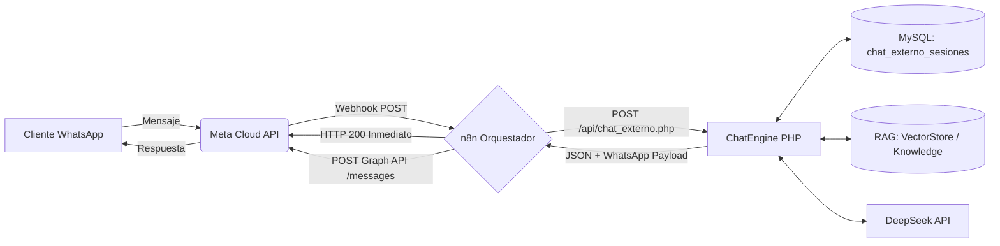

# 🚀 MANUAL DE INTEGRACIÓN: CHATBOT IA MULTICANAL (WHATSAPP, MESSENGER & N8N)

Este documento detalla la arquitectura desacoplada y los pasos para conectar el motor de Inteligencia Artificial de la tienda a canales externos como **WhatsApp Cloud API**, **Facebook Messenger**, **Telegram** o flujos de automatización en **n8n**, sin tocar el sistema web existente.

---

## 🏛️ Arquitectura Desacoplada (Agnóstica)



### Componentes Clave:
1. **[services/chat/ChatEngine.php](file:///c:/xampp/htdocs/ventas-ia-main/services/chat/ChatEngine.php):**  
   Motor centralizado independiente que encapsula:
   * Consulta de catálogo y categorías con precios oficiales fijos en Bolivianos (Bs).
   * Guardarraíles y personalidad humana vía [HumanPersona.php](file:///c:/xampp/htdocs/ventas-ia-main/services/chat/HumanPersona.php).
   * Recuperación semántica de políticas y FAQs vía [RagService.php](file:///c:/xampp/htdocs/ventas-ia-main/services/rag/RagService.php).
   * Formateador nativo para WhatsApp (negritas `*texto*`, viñetas y emojis sutiles).
2. **[api/chat_externo.php](file:///c:/xampp/htdocs/ventas-ia-main/api/chat_externo.php):**  
   Endpoint REST público protegido por `X-API-Key` con soporte para verificación de Webhooks de Meta (`hub.challenge`).
3. **Tabla `chat_externo_sesiones`:**  
   Persiste el historial de chat indexado por `(canal, remitente)` para mantener la memoria conversacional en WhatsApp sin depender de cookies ni localStorage.
4. **[integraciones/n8n_whatsapp_flow.json](file:///c:/xampp/htdocs/ventas-ia-main/integraciones/n8n_whatsapp_flow.json):**  
   Plantilla de flujo de n8n para importar con un clic, con respuesta inmediata `200 OK` para neutralizar el timeout de 5 segundos de Meta.

---

## 🔑 Especificación del Endpoint `api/chat_externo.php`

### 1. Verificación GET (Meta Webhook Handshake)
* **Método:** `GET`
* **URL:** `https://tu-dominio.com/api/chat_externo.php?hub.mode=subscribe&hub.challenge=123456&hub.verify_token=ical_chat_sec_2026`
* **Respuesta:** `123456` (en texto plano con código HTTP 200).

### 2. Procesamiento de Mensajes POST
* **Método:** `POST`
* **URL:** `https://tu-dominio.com/api/chat_externo.php`
* **Headers:**
  ```http
  Content-Type: application/json
  X-API-Key: ical_chat_sec_2026
  ```
* **Payload de Entrada (JSON):**
  ```json
  {
    "canal": "whatsapp",
    "remitente": "+59178901234",
    "mensaje": "¿Cuánto cuesta el iPhone 17 Pro Max y qué métodos de pago aceptan?",
    "use_rag": true
  }
  ```
* **Respuesta de Salida (JSON):**
  ```json
  {
    "ok": true,
    "canal": "whatsapp",
    "remitente": "+59178901234",
    "respuesta": "El iPhone 17 Pro Max está en Bs 18000.00. Aceptamos transferencias y QR simple con Banco Unión, BCP, BNB, Mercantil y Bisa.",
    "whatsapp_texto": "El *iPhone 17 Pro Max* está en *Bs 18000.00*.\n\nAceptamos transferencias y QR simple con Banco Unión, BCP, BNB, Mercantil y Bisa.\n\n📌 *iPhone 17 Pro Max* — Bs 18,000.00",
    "acciones": [
      {
        "tipo": "mostrar_producto",
        "id": 9,
        "nombre": "iPhone 17 Pro Max",
        "precio": 18000,
        "moneda": "Bs"
      }
    ],
    "rag_applied": true,
    "whatsapp_payload": {
      "messaging_product": "whatsapp",
      "recipient_type": "individual",
      "to": "+59178901234",
      "type": "text",
      "text": {
        "preview_url": false,
        "body": "El *iPhone 17 Pro Max*..."
      }
    }
  }
  ```

---

## 🛠️ Cómo Importar el Flujo en n8n (Paso a Paso)

1. Abre tu panel de **n8n** (local o en servidor).
2. Haz clic en **Workflows** → **Add Workflow** (o el botón `+`).
3. En la esquina superior derecha, selecciona **Import from File** y elige [integraciones/n8n_whatsapp_flow.json](file:///c:/xampp/htdocs/ventas-ia-main/integraciones/n8n_whatsapp_flow.json) (o copia y pega el contenido JSON directamente en el lienzo).
4. Configura las variables de entorno o credenciales en n8n:
   * `CHAT_API_URL`: URL pública HTTPS hacia tu servidor (ej. con ngrok: `https://xxxx.ngrok-free.app/api/chat_externo.php`).
   * `CHAT_EXTERNAL_API_KEY`: `ical_chat_sec_2026` (o la que definas en [config/config.php](file:///c:/xampp/htdocs/ventas-ia-main/config/config.php)).
   * `WHATSAPP_CLOUD_API_TOKEN`: Token de acceso permanente de Meta Developer Console.
5. Activa el interruptor **Active** del workflow.

---

## 🛡️ Pruebas Automatizadas y QA

El sistema incluye una suite de pruebas dedicadas para verificar la integridad del endpoint:

```bash
# Ejecutar solo la auditoría del endpoint externo:
php tests/test_chat_externo.php

# Ejecutar la suite completa de 15 pruebas de regresión del sistema:
php tests/run_all_tests.php
```

Ambas pruebas validan:
* Bloqueo contra peticiones no autorizadas (HTTP 401).
* Retención de contexto conversacional por número de teléfono en MySQL.
* Integridad de precios oficiales fijos en Bolivianos (inmune a regateos o alucinaciones).
* Prevención de falsos positivos en el carrito.
