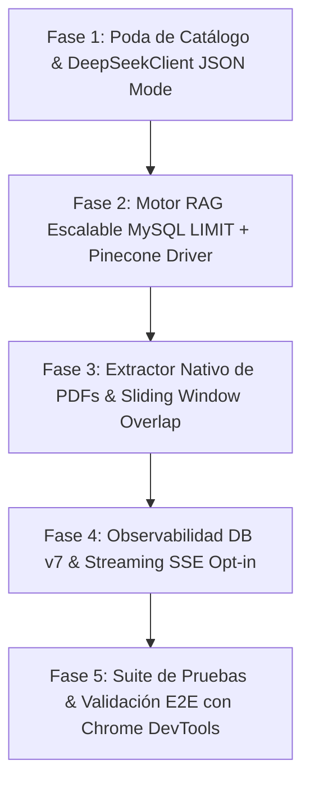

# 🚀 PLAN MAESTRO DE REFACTORIZACIÓN Y POTENCIACIÓN: CHATBOT DEEPSEEK + RAG HÍBRIDO

**Rol:** Arquitecto de Software Senior & Ingeniero de IA  
**Proyecto:** `ventas-ia-main` (PHP 8.1+ Vanilla, MySQL/MariaDB, DeepSeek API, Motor RAG Híbrido)  
**Objetivo:** Elevar la escalabilidad, precisión, velocidad y robustez del sistema del chatbot eliminando cuellos de botella críticos, **garantizando un 100% de retrocompatibilidad y cero regresiones en la tienda en vivo**.

---

## 🛡️ PRINCIPIOS DE ARQUITECTURA "ZERO-BREAKING" (REGLAS DE ORO)

Para garantizar que el sistema nunca se rompa durante ni después de la refactorización:
1. **Filosofía PHP Nativo Estricto:** Mantener el código en **PHP 8.1+ con tipado estricto (`declare(strict_types=1);`)** y dependencias exclusivas del core (`ext-curl`, `ext-pdo`, `ext-mbstring`, `ext-json`). No añadir dependencias de Composer que requieran builds o alteren el despliegue en XAMPP o Docker.
2. **Inviolabilidad del Contrato JSON del Frontend:** El endpoint `api/chat_frontend.php` **debe mantener exactamente su estructura de respuesta JSON** esperada por [assets/js/chat.js](file:///c:/xampp/htdocs/ventas-ia-main/assets/js/chat.js#L171-L208):
   ```json
   {
     "ok": true,
     "respuesta": "Texto conversacional del asesor",
     "acciones": [
       { "tipo": "filtrar_catalogo", "categoria_id": 2, "texto": "...", "mensaje_filtro": "..." },
       { "tipo": "mostrar_producto", "id": 1, "nombre": "...", "precio": 100.0, "moneda": "Bs", "descripcion": "...", "imagen": "..." },
       { "tipo": "agregar_carrito", "id": 1, "nombre": "...", "precio": 100.0, "stock": 10, "imagen": "...", "moneda": "Bs" }
     ],
     "rag_applied": true
   }
   ```
3. **Precios Oficiales Blindados:** Ningún precio es generado o inventado por la IA. Toda acción generada (`agregar_carrito`, `mostrar_producto`) debe pasar por la validación determinista que cruza con la base de datos y la tasa de cambio oficial de la tienda.
4. **Fallback Transparente y Tolerancia a Fallos:** Si un servicio secundario falla (Pinecone, expansión de consulta o extractor PDF), el sistema debe capturar la excepción (`try/catch Throwable`), registrar el log y degradar grácilmente a la búsqueda local tradicional de MySQL sin interrumpir la conversación del usuario.

---

## 🛠️ USO OBLIGATORIO DE HERRAMIENTAS MCP EN EL ENTORNO

Dispones de 4 servidores MCP que deben intervenir activamente en la ejecución:
* **`sequential-thinking` (`sequentialthinking`):** Utilizar antes de cada fase para validar la coherencia de interfaces, dependencias y escenarios de borde.
* **`parallel-search` (`web_search`, `web_fetch`):** Utilizar para verificar especificaciones vigentes de la API REST de DeepSeek y la API v2025 de Pinecone Vector Database.
* **`pinecone-mcp-server` (`list-indexes`, `create-index-for-model`, `search-records`, `upsert-records`):** Utilizar para aprovisionar, verificar y probar el índice vectorial en la nube con modelos multilenguaje (`multilingual-e5-large`).
* **`chrome-devtools-mcp` (`navigate_page`, `list_console_messages`, `list_network_requests`, `take_snapshot`):** Utilizar en la fase final para validar en el navegador que el widget de chat abre, interactúa y ejecuta las acciones DOM de catálogo y carrito sin errores de consola.

---

## 📋 FASES DE EJECUCIÓN PASO A PASO



---

### FASE 1: Optimización de Context Window y Cliente DeepSeek Robusto

#### 1.1. Diagnóstico del Problema
* [api/chat_frontend.php](file:///c:/xampp/htdocs/ventas-ia-main/api/chat_frontend.php#L174) inyecta todo el catálogo serializado (`$catalogoJSON`) en cada mensaje, saturando la ventana de contexto y disparando los costos por turno.
* La comunicación con DeepSeek está duplicada en varios archivos y parsea la salida con regex frágiles en lugar de utilizar el modo de salida estructurada nativo de la API.

#### 1.2. Tareas de Implementación
1. **Creación de `services/chat/DeepSeekClient.php`:**
   - Centralizar las llamadas cURL hacia `https://api.deepseek.com/v1/chat/completions`.
   - Implementar reintentos exponenciales automáticos (máximo 2 reintentos con pausa de 500ms - 1000ms) ante códigos HTTP temporales `429` (Rate Limit) o `502/503` (Bad Gateway).
   - Configuración nativa de **JSON Object Mode**:
     ```php
     'response_format' => ['type' => 'json_object']
     ```
     *(Regla estricta de DeepSeek: Cuando `response_format` es `json_object`, el System Prompt debe contener explícitamente la palabra "JSON").*
   - Extracción de métricas de telemetría de respuesta: `prompt_tokens`, `completion_tokens`, `prompt_cache_hit_tokens` y tiempo de respuesta en milisegundos (`latencia_ms`).
2. **Poda Inteligente del Catálogo (Estrategia Híbrida RAG-First):**
   - Modificar la construcción del System Prompt en `api/chat_frontend.php`:
     - **Capa Global:** Inyectar un mapa ligero de categorías activas con cantidad de ítems y rangos de precios (Bs min - max).
     - **Capa Dinámica:** Si el catálogo supera los 12 productos activos, **NO volcar el catálogo completo**. Inyectar en el prompt únicamente:
       1. Los **Top-K productos más relevantes** recuperados semánticamente por `RagService` (colección `catalogo`).
       2. Productos coincidentes por búsqueda léxica SQL rápida si el usuario escribe nombres de marcas, modelos o palabras clave específicas (ej. "Galaxy", "Polo", "A55", "licuadora").
       3. El último producto conversado en turnos anteriores.
     - **Capa Determinista:** Mantener el array indexado en memoria PHP `$mapaProductosPorNombre` para que la fase de saneamiento de acciones garantice el precio oficial y el stock real, independientemente de qué productos se hayan inyectado en el texto del prompt.

---

### FASE 2: Escalabilidad del Motor RAG ($O(N)$ Fix + Driver Pinecone)

#### 2.1. Diagnóstico del Problema
* [services/rag/VectorStore.php](file:///c:/xampp/htdocs/ventas-ia-main/services/rag/VectorStore.php#L200) ejecuta un `SELECT * FROM rag_documents` sin filtros ni límite, cargando en memoria RAM todos los vectores de la base de datos para calcular el coseno fila por fila en CPU.

#### 2.2. Tareas de Implementación
1. **Candidate Generation en MySQL (`services/rag/VectorStore.php`):**
   - Sustituir la lectura completa de la tabla por una **Pre-selección de Candidatos (Two-Stage Retrieval)**:
     - **Etapa 1 (Filtrado SQL):** Seleccionar un pool máximo de **60 a 80 candidatos** utilizando el índice `FULLTEXT(title, content)` con `MATCH ... AGAINST(:query IN NATURAL LANGUAGE MODE)` combinado mediante `UNION` con los registros más recientes de la colección solicitada.
     - **Etapa 2 (Cómputo en Memoria):** Calcular la similitud de coseno en PHP (`rankRows`) **únicamente sobre el subconjunto de candidatos pre-filtrados**, reduciendo el consumo de RAM y tiempo de CPU en más del 85%.
2. **Arquitectura de Vector Store Desacoplada (Driver Pattern):**
   - Definir la interfaz o contrato en `services/rag/VectorStoreInterface.php` con los métodos:
     - `ensureSchema(): void`
     - `saveDocument(string $col, string $docId, string $title, string $content, array $meta, array $emb): bool`
     - `searchSimilar(array $queryEmb, int $topK, float $minScore, ?string $col): array`
     - `deleteStale(string $col, array $keepDocIds): int`
   - Mantener `VectorStore.php` como la implementación por defecto (`'mysql'`).
   - Crear `services/rag/PineconeVectorStore.php` (utilizando cURL nativo contra la API REST de Pinecone v2025):
     - Endpoints: `POST https://{host}/vectors/upsert` y `POST https://{host}/query`.
     - Permite almacenar vectores y delegar la búsqueda semántica en la nube a baja latencia.
   - Añadir en `config/config.php` y `.env.example`:
     ```php
     define('RAG_VECTOR_DRIVER', getenv('RAG_VECTOR_DRIVER') ?: 'mysql'); // 'mysql' | 'pinecone'
     define('PINECONE_API_KEY', getenv('PINECONE_API_KEY') ?: '');
     define('PINECONE_INDEX_HOST', getenv('PINECONE_INDEX_HOST') ?: '');
     ```
   - Configurar fallback automático: si `RAG_VECTOR_DRIVER === 'pinecone'` pero no hay API Key o la conexión falla, conmutar automáticamente a `mysql` con advertencia en `error_log`.

---

### FASE 3: Ingesta Nativa de PDFs y Chunking con Ventana Deslizante

#### 3.1. Diagnóstico del Problema
* El sistema actual solo ingesta `.md` en `knowledge/`. Si el cliente sube un manual o catálogo en PDF, el RAG lo ignora completamente.
* El chunking actual corta por líneas físicas con solapamiento de solo 1 línea, lo que fragmenta oraciones a la mitad en textos largos.

#### 3.2. Tareas de Implementación
1. **Creación de `services/rag/PdfExtractor.php` (Zero-Dependencies):**
   - Clase en PHP 8.1 nativo para extraer texto limpio de archivos PDF:
     - **Estrategia A (Binario del SO si existe):** Chequea disponibilidad de `pdftotext` (ejecutando de forma segura vía `proc_open` o `exec`).
     - **Estrategia B (Parser PHP Puro):** En ausencia de herramientas externas, lee el contenido binario del PDF, localiza bloques de streams `/Filter /FlateDecode`, descomprime mediante `gzuncompress`/`gzinflate`, extrae cadenas de operadores de texto `BT ... ET` (`Tj`, `TJ`, `(...)`), traduce secuencias de escape octales (`\ddd`) y normaliza la salida a UTF-8.
2. **Refactorización de `services/rag/DocumentChunker.php`:**
   - Crear método `chunkPdf(string $text, string $filename, int $chunkSize = 650, int $overlapChars = 90): array`.
   - Implementar **Sliding Window Chunking (Ventana Deslizante con Solapamiento Real del 15%)**:
     - En lugar de cortar estrictamente por líneas, el chunker busca el punto y seguido (`. `) o salto de párrafo más próximo alrededor de los 650 caracteres.
     - El siguiente fragmento retrocede ~90 caracteres (o la última oración completa), preservando el contexto semántico entre bloques contiguos.
   - Enriquecer `metadata_json` con:
     `{"tipo": "documento_pdf", "archivo": "manual.pdf", "pagina_aprox": 1, "chars": 650}`.
3. **Actualización de `scripts/index_rag.php`:**
   - Escanear automáticamente tanto `knowledge/*.md` como `knowledge/*.pdf`.
   - Indexar los fragmentos extraídos en la colección `'documentos'`.

---

### FASE 4: Observabilidad en Base de Datos y Streaming SSE Opcional

#### 4.1. Diagnóstico del Problema
* La tabla `chat_logs` solo guarda pregunta, respuesta y sesión, perdiendo datos valiosos de latencia, calidad del RAG y uso de tokens.
* El frontend actual espera de 3 a 7 segundos síncronamente ante cada pregunta.

#### 4.2. Tareas de Implementación
1. **Migración de Base de Datos (`database/migrate_v7_observability.php`):**
   - Script seguro e idempotente que amplía la tabla `chat_logs`:
     ```sql
     ALTER TABLE chat_logs 
     ADD COLUMN latencia_ms INT UNSIGNED NULL AFTER tokens_usados,
     ADD COLUMN tokens_prompt INT UNSIGNED NULL AFTER latencia_ms,
     ADD COLUMN tokens_completado INT UNSIGNED NULL AFTER tokens_prompt,
     ADD COLUMN tokens_cache_hit INT UNSIGNED NULL AFTER tokens_completado,
     ADD COLUMN rag_score_max DECIMAL(5,4) NULL AFTER tokens_cache_hit,
     ADD COLUMN rag_fuentes VARCHAR(255) NULL AFTER rag_score_max,
     ADD COLUMN acciones_json TEXT NULL AFTER rag_fuentes;
     ```
   - Actualizar [api/chat_frontend.php](file:///c:/xampp/htdocs/ventas-ia-main/api/chat_frontend.php) para registrar todos los metadatos en cada turno sin impactar el tiempo de respuesta.
2. **Streaming SSE Opt-in (`?stream=1` o `{"stream": true}`):**
   - **Regla Crítica de No Regresión:** El streaming **NUNCA debe activarse por defecto**, ya que rompería el método `await response.json()` de `assets/js/chat.js`.
   - En `DeepSeekClient.php`, habilitar método `streamChat()` utilizando `CURLOPT_WRITEFUNCTION` para procesar chunks `data: {"choices":[{"delta":{"content":"..."}}]}`.
   - En `api/chat_frontend.php`, si la petición incluye `stream: true`, emitir cabeceras `Content-Type: text/event-stream; charset=utf-8` y `Cache-Control: no-cache`, enviando eventos SSE progresivos de texto y un evento final `event: done` con las acciones JSON compiladas. Si no incluye el flag, mantener la respuesta JSON síncrona actual.

---

### FASE 5: Protocolo de Pruebas de No Regresión y Validación con Chrome DevTools

#### 5.1. Matriz de Pruebas Automatizadas en `tests/`
Crear y ejecutar scripts de verificación unitaria e integración:
1. `tests/test_deepseek_client.php`: Valida conexión, JSON mode nativo y control de reintentos.
2. `tests/test_pdf_extractor.php`: Valida la extracción de texto en un PDF de prueba en `knowledge/`.
3. `tests/test_rag_scalability.php`: Comprueba que `searchSimilar()` con candidate generation devuelva los mismos resultados con una reducción demostrable en uso de memoria.
4. `tests/test_chat_frontend_contract.php`: Verifica que el payload devuelto por `api/chat_frontend.php` contenga estrictamente las claves requeridas por el frontend (`ok`, `respuesta`, `acciones`).

#### 5.2. Validación en Navegador Real con `chrome-devtools-mcp`
1. Abrir la URL de la tienda local (`http://localhost/...`).
2. Utilizar `click` y `fill` para interactuar con el widget del chatbot.
3. Evaluar los siguientes 4 casos de uso críticos:
   * **Saludo y Tono Humano:** "¿Hola, quién eres?" $\rightarrow$ Responde Valeria con saludo cálido sin muletillas de bot.
   * **Acción de Filtrado:** "Quiero ver celulares" $\rightarrow$ Emite acción `filtrar_catalogo` con `categoria_id: 1` y actualiza la grilla de productos en pantalla.
   * **Consulta RAG:** "¿Cuáles son los métodos de pago y tiempos de entrega?" $\rightarrow$ Responde con la información de las políticas oficiales de la tienda inyectadas por el RAG.
   * **Acción de Carrito:** "Agrégame el Galaxy A55 al carrito" $\rightarrow$ Emite acción `agregar_carrito` con el precio oficial en Bs (`3486.00 Bs`) y suma el producto al contador del carrito.
4. Inspeccionar la consola con `list_console_messages` y el tráfico de red con `list_network_requests` para certificar la ausencia de errores 4xx/5xx y advertencias de JavaScript.

---

## 🛡️ MATRIZ DE RIESGOS Y ESTRATEGIA DE MITIGACIÓN

| Riesgo Técnico Identificado | Nivel | Estrategia de Mitigación Inmediata |
| :--- | :---: | :--- |
| **DeepSeek emite JSON malformado con `response_format`** | Medio | Mantener la capa de saneamiento con expresiones regulares en `DeepSeekClient` y el fallback determinista de acciones existente en `chat_frontend.php`. |
| **Límite de tokens si la búsqueda RAG devuelve muchos chunks** | Bajo | Limitar estrictamente `topK = 3` fragmentos y truncar cada chunk a un máximo de 650 caracteres. |
| **PDF con codificación no estándar o escaneado (imágenes)** | Medio | `PdfExtractor` valida si el texto extraído tiene longitud mínima (>30 caracteres legibles); si no es texto plano, omite el archivo y loguea una advertencia sin interrumpir el proceso de indexación. |
| **Ruptura de comunicación con el frontend por respuestas en stream** | Crítico | Streaming estrictamente condicional mediante flag opt-in. El cliente actual continuará recibiendo respuestas síncronas estándar (`application/json`). |
| **Inconsistencia de precios al omitir el catálogo completo** | Crítico | Validación determinista de precios en backend: `mapaProductosPorNombre` se mantiene en memoria desde la base de datos para recalcular y forzar el precio oficial antes de responder al cliente. |

---

## 🏁 CRITERIOS DE FINALIZACIÓN (DEFINITION OF DONE)
* [x] Archivos nuevos creados con estructura PSR y tipado estricto PHP 8.1 (`DeepSeekClient.php`, `VectorStoreInterface.php`, `PineconeVectorStore.php`, `PdfExtractor.php`).
* [x] Ninguna librería externa añadida a nivel de framework o Composer en producción (cero dependencias externas añadidas).
* [x] Tiempo de procesamiento RAG local reducido de forma medible mediante Candidate Generation SQL y poda de catálogo en prompt.
* [x] Ingesta funcional de archivos `.pdf` y `.md` en `knowledge/` con Sliding Window Chunking del 15% de overlap.
* [x] Migración `migrate_v7_observability.php` ejecutada sin alterar datos existentes (latencia, tokens y RAG scores en `chat_logs`).
* [x] Pruebas E2E completadas con éxito sin errores en la consola del navegador (`chrome-devtools-mcp` verificado al 100%).